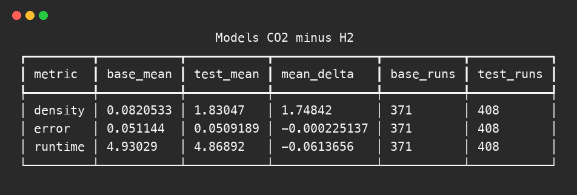
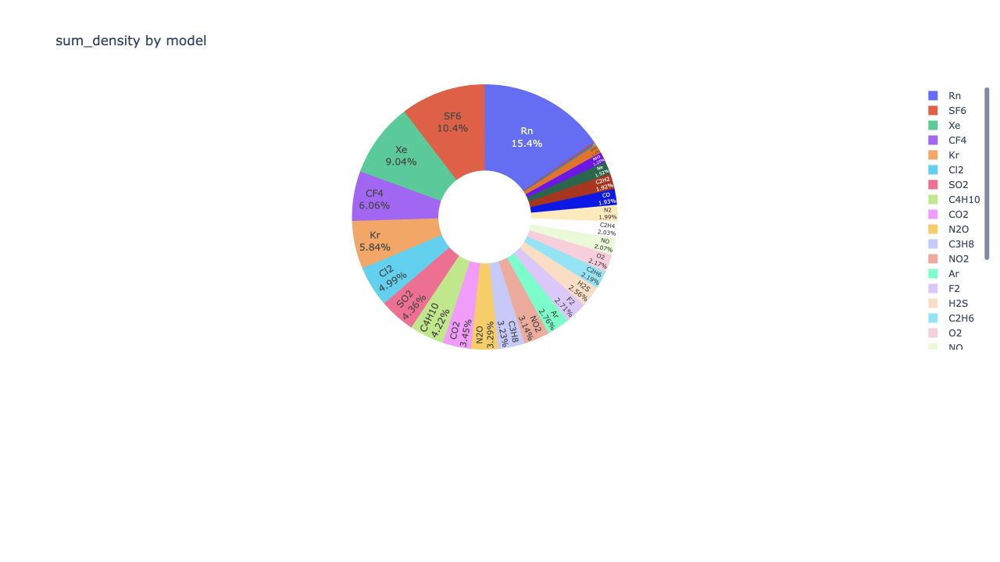
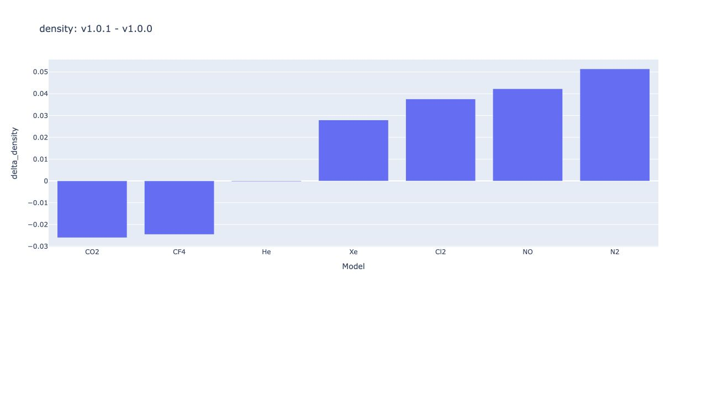

# Command line

The `qa_tool` command mirrors the aggregate web views for scripting, CI jobs, and remote terminals. It prints Rich tables and writes reproducible files for every plot.

{ loading=lazy }

The CLI writes the same Plotly figures used for the aggregate web views. This is a generated `H2` density-by-version report:

{ loading=lazy }

The interactive source is available as [model_H2_density.html](assets/model_H2_density.html).

CLI tables are rendered directly with Rich. This is a captured model-collection comparison from the local run database:

{ loading=lazy }

The captured terminal source is available as [rich-comparison-table.html](assets/rich-comparison-table.html).

## Common options

Every command accepts:

```text
--database PATH       Override the database from settings.
--settings PATH       TOML override using the web-app settings format.
--output-dir PATH     Destination directory (default: qa_tool_output).
--metric NAME         Numeric metric to plot; every numeric metric by default.
--formats ...         One or more of html png csv parquet.
--verbose             Print the paths of generated artifacts.
```

By default, the CLI produces a plot for **every numeric metric** and uses `--formats html png csv parquet`. Use `--metric` to restrict a command to one metric. Each plot base name produces:

| File | Contents |
| --- | --- |
| `name.html` | Interactive Plotly figure. |
| `name.png` | Static figure, when the Kaleido browser backend is available. |
| `name.csv` / `name.parquet` | Raw dataframe used as the plot input. |
| `name_table.csv` / `name_table.parquet` | The aggregate table displayed in the terminal. |

To emit only portable data alongside an interactive plot:

```bash
--formats html csv parquet
```

## Model reports

Print a table grouped by version for each model and generate one trend plot per selected model **and numeric metric**:

```bash
uv run qa_tool model --models h2 co2 --metric density
uv run qa_tool model --models h2 --metric error --formats png csv
# Omit --metric to create density, error, and every other available metric plot.
uv run qa_tool model --models h2 co2
```

## Version reports

Print one model table per version, generate multi-model trend plots, and generate model-mean empirical CDFs. Without `--metric`, all numeric variables are included:

```bash
uv run qa_tool version \
  --versions v1.0.0 v2.0.0 v2.1.0 \
  --metric density \
  --cdf-version v2.1.0
```

## Compare versions

Compare versions across their shared models. The table includes base/test means and standard deviations, percentage differences, and percentage uncertainty, followed by a percentage-difference bar chart and a CDF comparison.

```bash
uv run qa_tool compare versions \
  --base-version v1.0.0 \
  --test-version v2.0.0 \
  --metric density
```

Use this when `version` is an exact release identifier. To compare version *families* or any other metadata field, use `compare collections` below.

## Compare model collections

Compare the aggregate value of two explicit model selections. This is useful when the model groups themselves are the experimental condition.

```bash
uv run qa_tool compare models \
  --base-models h2 he \
  --test-models co2 ar \
  --metric error
```

## Compare arbitrary collections

Select base and test rows with any column in `runs`, then compare their shared models. This is the flexible comparison command: `--field` names the database column, `--base` and `--test` supply one or more values, and `--match` controls how those values select rows. Omit `--metric` to produce reports for every numeric metric.

=== "Version prefixes"

    Compare all patch releases beginning with `v1.0` against every release beginning with `v2.0`:

    ```bash
    uv run qa_tool compare collections \
      --field version \
      --base v1.0 \
      --test v2.0 \
      --match starts-with \
      --metric density
    ```

=== "Exact values"

    Compare two exact Git branches:

    ```bash
    uv run qa_tool compare collections \
      --field git_branch --base main --test release \
      --match exact --metric density
    ```

    More than one value may be supplied on either side. This compares the union of `main` and `release/1.0` against `candidate`:

    ```bash
    uv run qa_tool compare collections \
      --field git_branch \
      --base main release/1.0 \
      --test candidate \
      --match exact \
      --metric error
    ```

=== "Contains"

    Select names that contain the provided text, case-insensitively:

    ```bash
    uv run qa_tool compare collections \
      --field job_name --base baseline --test candidate \
      --match contains --metric error
    ```

=== "Regular expressions"

    Compare benchmark jobs from two naming schemes. Quote regular expressions so the shell does not interpret them:

    ```bash
    uv run qa_tool compare collections \
      --field job_name \
      --base '^baseline-(cpu|gpu)-' \
      --test '^candidate-(cpu|gpu)-' \
      --match regex \
      --metric density
    ```

=== "Boolean metadata"

    Compare runs based on a Boolean metadata column. Accepted values include `true`, `false`, `yes`, and `no`:

    ```bash
    uv run qa_tool compare collections \
      --field modified --base false --test true \
      --match exact --metric density
    ```

=== "Date windows"

    For a date or timestamp field, provide an inclusive start and end value for each collection:

    ```bash
    uv run qa_tool compare collections \
      --field date \
      --base 2026-01-01 2026-01-31 \
      --test 2026-02-01 2026-02-28 \
      --metric density
    ```

The available `--match` modes are `exact`, `starts-with`, `contains`, `regex`, and `non-empty`. `non-empty` selects every populated value in the field, so it is mainly useful for checking that a field is populated rather than for making two distinct collections. Datetime fields always use the inclusive start/end windows shown above.

### Terse collection deltas

Use `--terse` when you want a single, compact table rather than the usual full table, Plotly difference chart, and CDF for each metric. It prints only `model`, `metric`, and `difference (%)`; it does not write artifacts. With no `--metric`, every numeric metric is included in the same table:

```bash
qa_tool compare collections \
  --field version --base v1.0 --test v2.0 \
  --match starts-with --terse
```

Add `--metric density` to limit that terse table to one quantity.

## Pie charts

Build donut charts by model or version. Omit `--metric` to generate the run-count chart **and** one summed chart for every numeric metric; include it to generate only that metric's sum.

```bash
uv run qa_tool pie --slice-by model
uv run qa_tool pie --slice-by version --metric density
```

Here is a generated CLI `sum_density by model` chart. The interactive output is available as [pie_model_sum_density.html](assets/pie_model_sum_density.html).

{ loading=lazy }

Version comparisons also emit model-level percentage-difference plots. This example compares `v1.0.0` with `v1.0.1`; open the [interactive Plotly chart](assets/compare_versions_v1.0.0_to_v1.0.1_density.html) for hover details.

{ loading=lazy }

## PNG troubleshooting

PNG uses Kaleido and a local Chrome-compatible browser. If PNG rendering is unavailable, the command prints a warning but retains all other selected artifacts. Either install/repair a supported browser or explicitly omit PNG:

```bash
uv run qa_tool model --models h2 --formats html csv parquet
```
