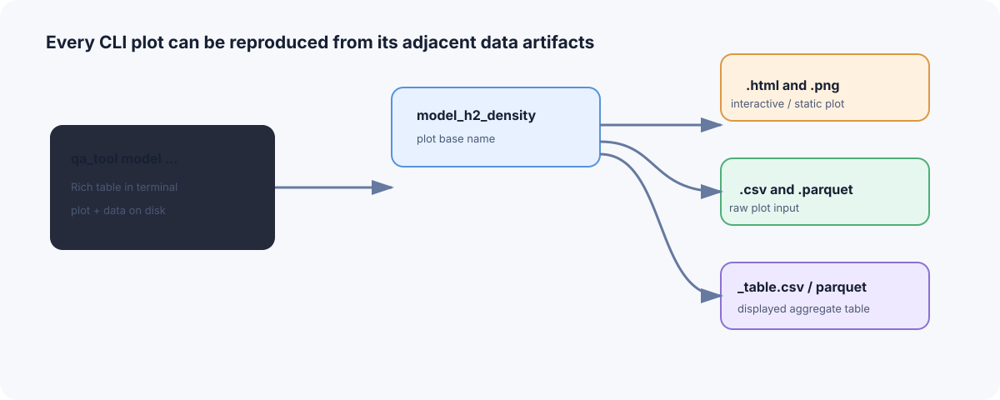
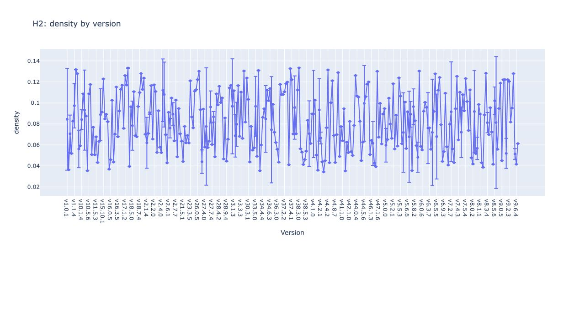

# Command line

The `qa-tool` Rich Click command tree covers ingestion, the web app, and terminal analysis from one entry point:

```text
qa-tool
├── ingest
├── serve
├── report
│   ├── models
│   ├── versions
│   └── breakdown
├── compare
│   ├── versions
│   ├── models
│   ├── collections
│   └── runs
├── check
│   ├── versions
│   ├── models
│   └── collections
└── archive
    ├── list
    ├── show
    ├── verify
    └── export
```

Run `qa-tool COMMAND --help` for Rich-formatted options and arguments. The analysis commands mirror the aggregate web views for scripting, CI jobs, and remote terminals.

{ loading=lazy }

The CLI writes the same Plotly figures used for the aggregate web views. This is a generated `H2` density-by-version report:

{ loading=lazy }

The interactive source is available as [model_H2_density.html](assets/model_H2_density.html).

CLI tables are rendered directly with Rich. This is a captured model-collection comparison from the local run database:

{ loading=lazy }

The captured terminal source is available as [rich-comparison-table.html](assets/rich-comparison-table.html).

## Report options

The `report models`, `report versions`, and `report breakdown` commands accept:

```text
--database PATH       Override the database from settings.
--settings PATH       TOML override using the web-app settings format.
--output-dir PATH     Destination directory (default: qa_tool_output).
--metric NAME         Numeric metric to plot; every numeric metric by default.
--format FORMAT       Output format; repeat for several.
```

By default, the CLI produces a plot for **every numeric metric** and writes HTML, CSV, and Parquet. Use `--metric` to restrict a command to one metric. See [Plots and exports](plotting.md) for file naming, PNG installation, and format behaviour.

Comparison commands instead write one complete, uniquely identified snapshot to `[archive].save_path` (which defaults to `qa_tool_archive/`). They accept `--database`, `--settings`, `--metric`, and `--archive-dir`. See [Comparison archives](comparison-archives.md) for the file format and recovery workflow.

`check` commands evaluate version, model, or arbitrary collections against a
TOML regression policy, emit standard JUnit XML, preserve the result, and use
exit code 1 for an evaluated policy failure. See [Regression gates](regression-gates.md).

Reports print a concise output destination by default. Use the top-level `--verbose` option to list every generated file, for example `qa-tool --verbose report models h2`.

## Model reports

Print a table grouped by version for each model and generate one trend plot per selected model **and numeric metric**:

```bash
qa-tool report models h2 co2 --metric density
qa-tool report models h2 --metric error --format png --format csv
# Omit --metric to create density, error, and every other available metric plot.
qa-tool report models h2 co2
```

## Version reports

Print one model table per version, generate multi-model trend plots, and generate model-mean empirical CDFs. Without `--metric`, all numeric variables are included:

```bash
qa-tool report versions v1.0.0 v2.0.0 v2.1.0 \
  --metric density \
  --cdf-version v2.1.0
```

Versions use PEP 440 ordering rather than string ordering, so `v1.10` follows `v1.9` and prerelease/postrelease markers retain their standard positions. See [Version ordering](database.md#version-ordering).

## Compare versions

Compare versions across their shared models. The terminal table includes base/test means and standard deviations, percentage differences, and percentage uncertainty. The selected input rows, typed result table, standalone plotted report, manifest, and checksums are saved together.

```bash
qa-tool compare versions v1.0.0 v2.0.0 --metric density
```

Use this when `version` is an exact release identifier. To compare version *families* or any other metadata field, use `compare collections` below.

## Compare model collections

Compare the aggregate value of two explicit model selections. This is useful when the model groups themselves are the experimental condition.

```bash
qa-tool compare models \
  --base h2 --base he \
  --test co2 --test ar \
  --metric error
```

## Compare individual runs

Select two runs by their stable UID. The second run is treated as the test/bottom side, so the recorded delta is `bottom - top`.

```bash
qa-tool compare runs run-001 run-002 --metric density
```

## Compare arbitrary collections

Select base and test rows with any column in `runs`, then compare their shared models. This is the flexible comparison command: `--field` names the database column, `--base` and `--test` supply one or more values, and `--match` controls how those values select rows. Omit `--metric` to produce reports for every numeric metric.

=== "Version prefixes"

    Compare all patch releases beginning with `v1.0` against every release beginning with `v2.0`:

    ```bash
    qa-tool compare collections \
      --field version \
      --base v1.0 \
      --test v2.0 \
      --match starts-with \
      --metric density
    ```

=== "Exact values"

    Compare two exact Git branches:

    ```bash
    qa-tool compare collections \
      --field git_branch --base main --test release \
      --match exact --metric density
    ```

    More than one value may be supplied on either side. This compares the union of `main` and `release/1.0` against `candidate`:

    ```bash
    qa-tool compare collections \
      --field git_branch \
      --base main --base release/1.0 \
      --test candidate \
      --match exact \
      --metric error
    ```

=== "Contains"

    Select names that contain the provided text, case-insensitively:

    ```bash
    qa-tool compare collections \
      --field job_name --base baseline --test candidate \
      --match contains --metric error
    ```

=== "Regular expressions"

    Compare benchmark jobs from two naming schemes. Quote regular expressions so the shell does not interpret them:

    ```bash
    qa-tool compare collections \
      --field job_name \
      --base '^baseline-(cpu|gpu)-' \
      --test '^candidate-(cpu|gpu)-' \
      --match regex \
      --metric density
    ```

=== "Boolean metadata"

    Compare runs based on a Boolean metadata column. Accepted values include `true`, `false`, `yes`, and `no`:

    ```bash
    qa-tool compare collections \
      --field modified --base false --test true \
      --match exact --metric density
    ```

=== "Date windows"

    For a date or timestamp field, provide an inclusive start and end value for each collection:

    ```bash
    qa-tool compare collections \
      --field date \
      --base 2026-01-01 --base 2026-01-31 \
      --test 2026-02-01 --test 2026-02-28 \
      --metric density
    ```

The available `--match` modes are `exact`, `starts-with`, `contains`, `regex`, and `non-empty`. `non-empty` selects every populated value in the field, so it is mainly useful for checking that a field is populated rather than for making two distinct collections. Datetime fields always use the inclusive start/end windows shown above.

### Terse collection deltas

Use `--terse` when you want a single, compact, ephemeral table rather than a saved snapshot. It prints only `model`, `metric`, and `difference (%)`; it does not write an archive. With no `--metric`, every numeric metric is included in the same table:

```bash
qa-tool compare collections \
  --field version --base v1.0 --test v2.0 \
  --match starts-with --terse
```

Add `--metric density` to limit that terse table to one quantity.

## Inspect saved comparisons

List snapshots, inspect their manifests, verify their integrity, or recover a standalone report:

```bash
qa-tool archive list
qa-tool archive show SNAPSHOT_ID
qa-tool archive verify SNAPSHOT_ID
qa-tool archive export SNAPSHOT_ID --output report.html
```

Archive commands read `[archive].search_paths` when supplied with `--settings`. Repeat `--archive-dir` to override that list and search several explicit locations:

```bash
qa-tool archive list --settings settings.toml
qa-tool archive list --archive-dir ./qa_tool_archive --archive-dir /shared/qa/comparisons
```

## Pie charts

Build donut charts by model or version. Omit `--metric` to generate the run-count chart **and** one summed chart for every numeric metric; include it to generate only that metric's sum.

```bash
qa-tool report breakdown --by model
qa-tool report breakdown --by version --metric density
```

Here is a generated CLI `sum_density by model` chart. The interactive output is available as [pie_model_sum_density.html](assets/pie_model_sum_density.html).

{ loading=lazy }

Saved comparison reports contain self-contained model-level percentage-difference plots. Unlike ordinary report HTML, their Plotly runtime is embedded so they remain usable offline.
