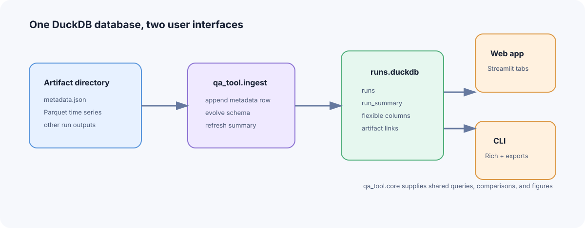

# QA Tool

QA Tool is a small system for collecting, browsing, comparing, and exporting quality-assurance run data. It stores run metadata in DuckDB, retains a link to each run's artifact directory, and offers the same analysis through a Streamlit web application or a Rich-powered command line.

{ loading=lazy }

## Choose an interface

| Need | Use |
| --- | --- |
| Explore runs interactively, filter, inspect artifacts, or compare individual runs | [Web application](web-app.md) |
| Automate reports, save plots, or work over SSH | [Command line](cli.md) |
| Add a new run and refresh the overview summary | [Ingestion](ingestion.md) |
| Install optional PNG or documentation support | [Installation](installation.md) |
| Choose plot and export formats | [Plots and exports](plotting.md) |

## Key ideas

- **One DuckDB database.** `runs` contains one row per run. `run_summary` contains precomputed overview values.
- **Flexible metadata.** The required source fields are `uid`, `date`, and configured model/version columns. New JSON keys become new DuckDB columns when ingested.
- **Artifact-aware.** The `artifact` column points to the directory that holds detailed outputs such as Parquet time series.
- **Shared calculations.** `qa_tool_core` owns the database queries, selections, comparisons, and Plotly figure builders used by both interfaces.

## Typical workflow

```text
metadata.json + artifact directory
        │
        ▼
qa-tool ingest
        │
        ▼
runs.duckdb  ──────────► Streamlit dashboard
        │
        └──────────────► qa-tool reports and export files
```

Start with [Getting started](getting-started.md), then use the [Configuration](configuration.md) guide to adapt paths and views to your data.
