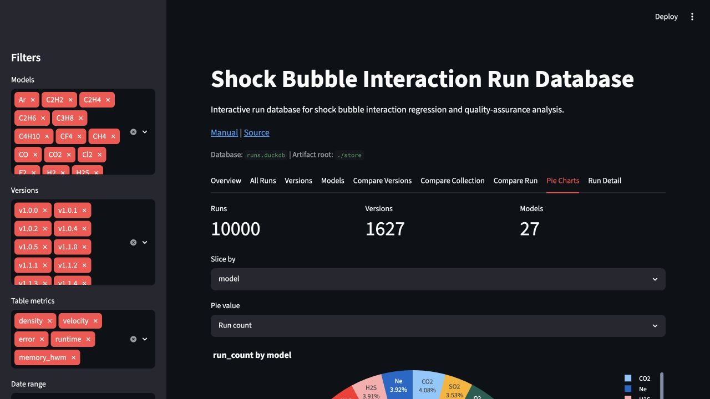
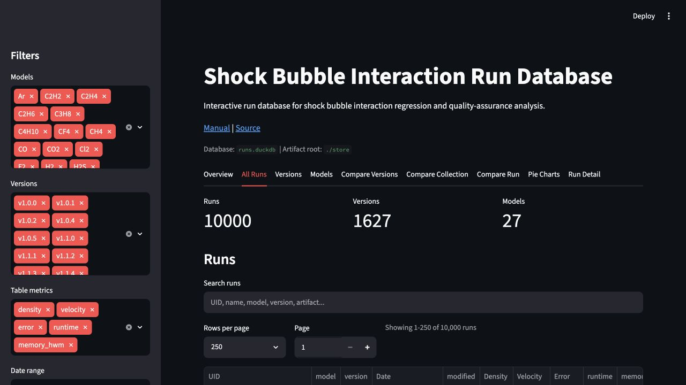

# Web application

Run the dashboard with:

```bash
qa-tool serve
```

## Run in Docker

Build the image from the repository root, then mount the DuckDB database and
artifact directory into the paths configured by the default settings:

```bash
docker build -t qa-tool .
docker run --rm -p 8501:8501 \
  -v "$PWD/runs.duckdb:/app/runs.duckdb" \
  -v "$PWD/store:/app/store:ro" \
  qa-tool
```

The dashboard is available at <http://localhost:8501>. `runs.duckdb` is
mounted read/write so it can also be updated by ingestion commands; `store` is
mounted read-only because the dashboard only reads artifacts. The Docker image
does not contain run data.

The Dockerfile defaults to `ghcr.io/astral-sh/uv:python3.13-bookworm-slim`.
Organizations using Harbor can point the build at an internal mirrored image:

```bash
docker build \
  --build-arg BASE_IMAGE=harbor.example.com/base/uv:python3.13-bookworm-slim \
  -t qa-tool .
```

Use the Harbor repository and tag supplied by your organization in place of
the example path.

{ loading=lazy }

Pass a settings override as usual:

```bash
qa-tool serve --settings settings.toml
```

See [Configuration](configuration.md) for database paths, column mappings, enabled tabs, summaries, and plot sizing. Additional Streamlit arguments can be passed after `--`, for example `qa-tool serve -- --server.port=8600`.

Pickle artifact previews are disabled by default because deserializing a pickle can execute arbitrary Python code on the dashboard server. For a local dashboard containing only artifacts you trust, enable them explicitly:

```bash
qa-tool serve --allow-unsafe-pickle
```

The option forces Streamlit to bind to `127.0.0.1` and rejects an explicitly public server address. Do not use it for a hosted or shared dashboard. Without it, pickle artifacts can be downloaded but are never loaded by the web application.

## Navigation and loading

The top tabs remain available on every page. The **Overview** splash page shows only stored summary quantities and navigation cards. Detailed runs are loaded only after you open another tab, keeping the initial page responsive even for a large database.

Database-backed pages inspect the schema first, project only the columns needed by the active view, and apply the shared filters in DuckDB. **All Runs** uses database-backed pagination rather than loading the complete table. Other analytical views materialize at most `[database].max_query_rows` rows and warn when the filtered selection is larger; summary cards still use exact database-side aggregates. The supported representative target is one million run rows with the default 50,000-row analytical window.

Every view has a stable URL using its configuration key, for example:

```text
https://qa.example.org/?view=all_runs
https://qa.example.org/?view=compare_versions
https://qa.example.org/?view=saved_comparisons
```

Changing tabs updates the browser address, so copy that address to link another user directly to the current view. Disabled or unknown views fall back to the first enabled tab.

Database-backed views show the resolved data revision, modification time, size, and cache TTL. Use **Refresh database** to clear only cached runs and stored summaries and reload the current revision immediately. The dashboard otherwise detects promoted snapshots from the resolved file identity and uses the configured TTL as a bounded-staleness fallback.

## Main pages

| Page | What it provides |
| --- | --- |
| Overview | Stored `run_summary` quantities and quick links. |
| All Runs | Filtered raw run table, configurable column order, and downloads. |
| Versions | Per-version model tables, version metric plots, and CDFs. |
| Models | Per-model version tables and per-model trend plots. |
| Compare Versions | Model-by-model differences between two versions. |
| Compare Collection | Select two collections by arbitrary metadata fields and compare them. |
| Compare Run | Scalar and artifact-level comparison of two individual runs. |
| Pie Charts | Run-count or metric-total donut charts by model or version. |
| Run Detail | Artifact inspection and Parquet time-series plots. |
| Saved Comparisons | Verify, inspect, and download comparison snapshots without recalculating from DuckDB. |

??? example "Example analysis paths"

    - To investigate a release regression, open **Compare Versions**, choose the earlier release as the base, select the candidate release, and preserve the result.
    - To isolate an environmental change, open **Compare Collection** and select rows by branch, scheduler, queue, date window, or another metadata field.
    - To inspect a single outlier, open **Compare Run** for scalar and shared Parquet-series differences, then use **Run Detail** to browse its remaining artifacts.
    - To revisit a decision after the live database changes, open **Saved Comparisons** and select the immutable snapshot ID.

The Pie Charts view turns the current filtered runs into a model- or version-based donut chart:

{ loading=lazy }

Compare Versions presents base/test means and standard deviations, percentage differences, and percentage uncertainty alongside the selected metrics:

{ loading=lazy }

## Filters and downloads

Non-overview pages expose shared model, version, date, and metric filters. The All Runs tab can download the current bounded page as CSV, JSON, or a pandas pickle. Choose the table's columns and order in `[tables.all_runs].columns`.

{ loading=lazy }

## Preserve comparisons

The three comparison pages include a collapsed **Preserve this comparison** section below their results. Saving records the complete selected database rows, calculated table, standalone report, manifest, and checksums in `[archive].save_path`. **Compare Run** additionally copies the resolved local artifact directories so its detailed source data remains available; the CLI run comparison does the same.

After saving, download the complete snapshot as a ZIP or open **Saved Comparisons** to verify and inspect it. The browser address is updated to a durable link such as `https://qa.example.org/?view=saved_comparisons&comparison=a8c41f92de10`; opening that link selects the Saved Comparisons tab and snapshot automatically. Copy the address to share the result with another authorized user of the hosted app. The shorter form containing only `?comparison=...` also works.

The page merges all configured `[archive].search_paths`, so local and shared archives can be browsed together. It reads snapshots rather than recalculating against the current database and remains available when the configured DuckDB file is absent. The receiving app instance must be able to read the linked snapshot; the URL contains its ID, not the archived data. Detailed manifests and input rows remain collapsed until requested. See [Comparison archives](comparison-archives.md) for the format and CLI recovery commands.

## Artifacts

The app resolves database-provided artifact locations only beneath the configured `artifact_root`; without that approved root, local artifact inspection is disabled. Parquet files with a time-like column are plotted as time series. Archive artifacts are validated against configured member, file, and expanded-size limits before being unpacked into a temporary location. Directory scans, rendered rows, and plotted points are also bounded. See [Artifact trust boundary and limits](configuration.md#artifact-trust-boundary-and-limits). Pickle files inside directories or archives follow the same disabled-by-default policy as standalone pickle artifacts.

!!! note

    Interactive artifact inspection remains web-only. The CLI can compare individual scalar run metadata and create a recoverable snapshot, but it does not render every artifact type in the terminal.
