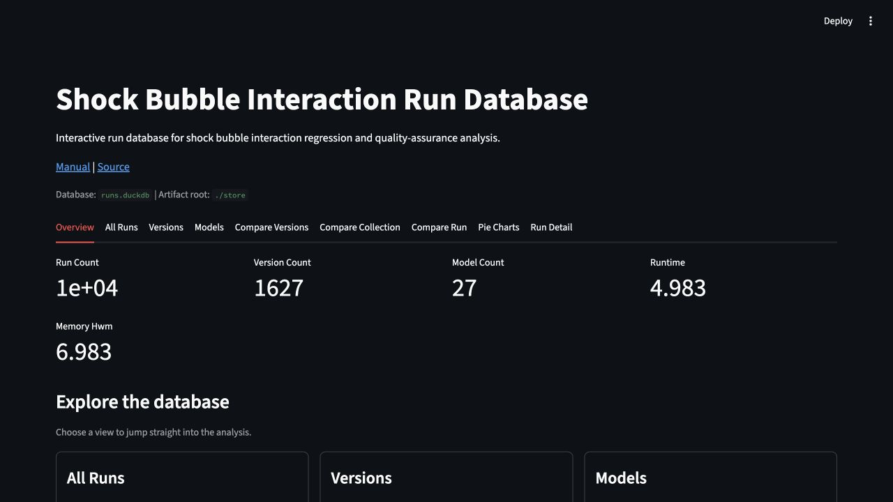
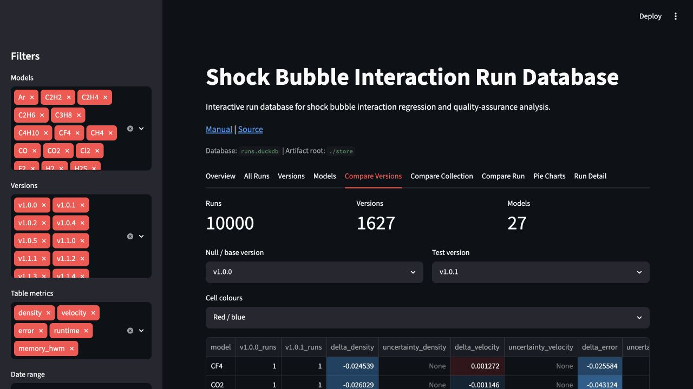

# Web application

Run the dashboard with:

```bash
qa-tool webapp
```

## Run in Docker

Build the image from the repository root, then mount the DuckDB database and
artifact directory into the paths configured by the default settings:

```bash
docker build -t qa-tool .
docker run --rm -p 8501:8501 \
  -v "$PWD/runs.duckdb:/app/runs.duckdb" \
  -v "$PWD/store:/app/store:ro" \
  qa-tool
```

The dashboard is available at <http://localhost:8501>. `runs.duckdb` is
mounted read/write so it can also be updated by ingestion commands; `store` is
mounted read-only because the dashboard only reads artifacts. The Docker image
does not contain run data.

The Dockerfile defaults to `ghcr.io/astral-sh/uv:python3.13-bookworm-slim`.
Organizations using Harbor can point the build at an internal mirrored image:

```bash
docker build \
  --build-arg BASE_IMAGE=harbor.example.com/base/uv:python3.13-bookworm-slim \
  -t qa-tool .
```

Use the Harbor repository and tag supplied by your organization in place of
the example path.

{ loading=lazy }

Pass a settings override as usual:

```bash
qa-tool webapp --settings settings.toml
```

See [Configuration](configuration.md) for database paths, column mappings, enabled tabs, summaries, and plot sizing. Additional Streamlit arguments can be passed after `--`, for example `qa-tool webapp -- --server.port=8600`.

## Navigation and loading

The top tabs remain available on every page. The **Overview** splash page shows only stored summary quantities and navigation cards. Detailed runs are loaded only after you open another tab, keeping the initial page responsive even for a large database.

## Main pages

| Page | What it provides |
| --- | --- |
| Overview | Stored `run_summary` quantities and quick links. |
| All Runs | Filtered raw run table, configurable column order, and downloads. |
| Versions | Per-version model tables, version metric plots, and CDFs. |
| Models | Per-model version tables and per-model trend plots. |
| Compare Versions | Model-by-model differences between two versions. |
| Compare Collection | Select two collections by arbitrary metadata fields and compare them. |
| Compare Run | Scalar and artifact-level comparison of two individual runs. |
| Pie Charts | Run-count or metric-total donut charts by model or version. |
| Run Detail | Artifact inspection and Parquet time-series plots. |

The Pie Charts view turns the current filtered runs into a model- or version-based donut chart:

{ loading=lazy }

Compare Versions presents base/test means and standard deviations, percentage differences, and percentage uncertainty alongside the selected metrics:

{ loading=lazy }

## Filters and downloads

Non-overview pages expose shared model, version, date, and metric filters. The All Runs tab can download the filtered rows as CSV, JSON, or a pandas pickle. Choose the table's columns and order in `[tables.all_runs].columns`.

{ loading=lazy }

## Artifacts

The app combines `artifact` from the run row with `artifact_root` when locating local files. Parquet files with a time-like column are plotted as time series. Archive artifacts are unpacked safely into a temporary location before inspection.

!!! note

    Run Detail is intentionally web-only at present. The CLI covers aggregate tables, plots, and comparisons but does not yet inspect individual artifact contents.
